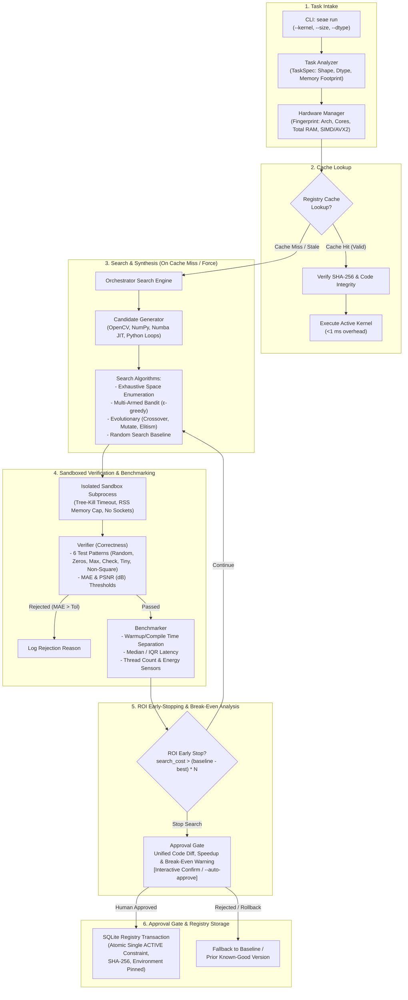

# SEAE: Self-Evolving Algorithm Engine

[](https://www.python.org/)
[](https://opensource.org/licenses/MIT)
[](https://docs.pytest.org/)

**SEAE** (Self-Evolving Algorithm Engine) is an autonomous, machine-adaptive systems runtime that generates, sandbox-verifies, benchmarks, and selects optimal image processing kernels per hardware architecture. It maintains an SQLite-backed registry keyed on machine hardware fingerprints and runtime library versions, enforcing cryptographic SHA-256 code integrity, human-in-the-loop diff approvals, ROI amortization enforcement, and transactional rollbacks.

---

## Status and Limitations

> [!WARNING]
> **Important Project Status and Research Boundaries**:
> - **Research prototype, not production software**: SEAE is an exploratory research runtime exploring continuous search and kernel synthesis; it is not hardened for production environments.
> - **Single-Machine Hardware Specificity**: All results and measurements reported in this repository originate from a single Windows laptop (AMD Ryzen 7 5800H, 8 physical cores, 16 threads, AVX2). They may not generalize to other hardware.
> - **Sandbox Isolation Boundary**: The subprocess sandbox provides execution isolation for prototype benchmarking (timeout enforcement, peak RSS monitoring, and basic network socket blocking). It is an engineering harness against accidental infinite loops and memory leaks, **not a security boundary**.
> - **No Energy Measurements**: Hardware RAPL (Running Average Power Limit) energy counters are unavailable on Microsoft Windows host platforms without vendor-signed kernel drivers. Energy consumption figures are omitted rather than simulated.
> - **Automated Promotion Warning (--auto-approve)**: The `--auto-approve` CLI flag skips human review of generated code; do not use it with untrusted input.
> - **Preliminary Search Strategy Comparisons**: The search-strategy comparison (random vs bandit vs evolutionary search) is preliminary: only 5 seeds, small budgets (12 evaluations), and noisy timings.

---

## Architecture Overview



---

## Core Components

| Module | Responsibility |
| :--- | :--- |
| [`seae.task_analyzer`](file:///d:/Project/Chip/seae/task_analyzer.py) | Parses image geometry (`WxH`), data types (`uint8`, `float32`), kernel parameters (`ksize`, `sigma`, `thresh`), and calculates memory footprints. |
| [`seae.hardware_manager`](file:///d:/Project/Chip/seae/hardware_manager.py) | Queries logical/physical cores, total system RAM, SIMD capabilities (including explicit AVX2 detection), GPU presence, and hardware fingerprinting. Includes `FPGAPlaceholderBackend`. |
| [`seae.sandbox`](file:///d:/Project/Chip/seae/sandbox.py) | Spawns sandboxed worker subprocesses, enforces tree-kill timeouts, monitors peak resident set size (RSS), blocks network socket operations, and locates cross-platform Python executables. |
| [`seae.verifier`](file:///d:/Project/Chip/seae/verifier.py) | Tests candidate kernels against numerical golden references across 6 test patterns (uniform random, all-zeros, max-value, checkerboard, tiny 5x5, non-square 32x48). Computes MAE and PSNR with configurable float vs quantized tolerances. |
| [`seae.benchmarker`](file:///d:/Project/Chip/seae/benchmarker.py) | Executes repeated isolated benchmark runs. Isolates JIT compilation/warmup overhead from steady-state median runtime; synchronizes thread counts across backends and monitors memory and RAPL energy sensors. |
| [`seae.candidate_generator`](file:///d:/Project/Chip/seae/candidate_generator.py) | Generates candidate variants across OpenCV baselines, NumPy vectorized/separable pipelines, and Numba JIT (parallel loops, fastmath, 2D cache tiling, 1D separable passes). Supports Exhaustive, Random, $\epsilon$-Greedy Bandit, and Evolutionary Search. |
| [`seae.registry`](file:///d:/Project/Chip/seae/registry.py) | SQLite cache keyed on `(kernel_name, size, dtype, params, hw_fingerprint)`. Enforces SHA-256 integrity, detects environment version drift (`numpy`, `opencv`, `numba`), executes transactional rollbacks, and prohibits re-promoting `ROLLED_BACK` code. |
| [`seae.approval_gate`](file:///d:/Project/Chip/seae/approval_gate.py) | Interactive CLI approval screen displaying unified code diffs, speedups, break-even amortization warnings, and prompts for human confirmation before cache promotion. |
| [`seae.orchestrator`](file:///d:/Project/Chip/seae/orchestrator.py) | Orchestrates cache-first dispatch, budget enforcement (timeout + max candidate evaluation limit), ROI early-stopping, and break-even calculations. |
| [`seae.cli`](file:///d:/Project/Chip/seae/cli.py) | Command-line interface offering `run`, `history`, `rollback`, and `export` subcommands. |

---

## Setup & Installation

### Prerequisites
- Python 3.10 - 3.13
- Git

### Installation Steps

1. Clone or navigate to the repository directory:
   ```powershell
   cd d:\Project\Chip
   ```

2. Create a virtual environment:
   ```powershell
   python -m venv .venv
   ```

3. Activate the virtual environment:
   - **Windows (PowerShell)**:
     ```powershell
     .\.venv\Scripts\Activate.ps1
     ```
   - **Linux / macOS**:
     ```bash
     source .venv/bin/activate
     ```

4. Install pinned dependencies:
   ```powershell
   pip install -r requirements.txt
   ```

---

## Single Reproduction Command

Run all 39 unit tests and generate the complete empirical benchmark suite and visualization chart with a single command:

```powershell
python -m pytest -v && python run_benchmarks.py
```

---

## OpenCV Baseline Implementations

To ensure baseline fairness, OpenCV thread counts are set equal to Numba (`cv2.setNumThreads(8)`, `numba.set_num_threads(8)`), and OpenCV code uses native SIMD operations that produce the exact numerical reference output.

### Exact Baseline Code: Point-wise Thresholding
```python
import cv2

def kernel_entry(img, thresh=128.0, maxval=255.0, **kwargs):
    _, out = cv2.threshold(img, float(thresh), float(maxval), cv2.THRESH_BINARY)
    return out
```

### Exact Baseline Code: Sobel Edge Detection
```python
import cv2
import numpy as np

def kernel_entry(img, **kwargs):
    if img.ndim == 3:
        gray = cv2.cvtColor(img, cv2.COLOR_BGR2GRAY)
    else:
        gray = img
    gx = cv2.Sobel(gray, cv2.CV_32F, 1, 0, ksize=3, borderType=cv2.BORDER_REPLICATE)
    gy = cv2.Sobel(gray, cv2.CV_32F, 0, 1, ksize=3, borderType=cv2.BORDER_REPLICATE)
    mag = cv2.magnitude(gx, gy)
    if np.issubdtype(img.dtype, np.integer):
        return np.clip(np.round(mag), 0, 255).astype(img.dtype)
    return mag.astype(img.dtype)
```

---

## CLI Usage & Interactive Approval Walkthrough

> [!WARNING]
> **Approval Gate Safety Warning**: The `--auto-approve` CLI flag bypasses human code inspection and automatically promotes the fastest candidate to the active cache. Only use `--auto-approve` in automated test pipelines where interactive stdin is unavailable. In production, review the unified diff interactively.

### 1. Interactive Approval Prompt (Without `--auto-approve`)
When run without `--auto-approve`, SEAE presents the proposed code diff, measured speedup, and break-even invocations, prompting the reviewer for confirmation:

```powershell
python -m seae run --kernel sobel --size 256x256 --force-search --expected-invocations 500000
```
*Console Output:*
```text
=================================================================
                SEAE - KERNEL EXECUTION ENGINE
=================================================================
Kernel Target       : sobel
Resolution          : 256x256 (uint8)
Hardware Arch       : AMD64-16c-14gb-AVX2
Auto-Approve        : False
Expected Invocations: 500,000
Search Strategy     : evolutionary (Budget: 10 cands / 25.0s)
-----------------------------------------------------------------

======================================================================
  SEAE KERNEL PROMOTION APPROVAL GATE
======================================================================
Candidate ID : sobel_numba_0004
Task         : sobel [256x256]
Speedup      : 1.71x (0.574 ms -> 0.336 ms)
Break-Even   : 125,118 invocations (Expected: 500,000)
----------------------------------------------------------------------
PROPOSED CODE DIFF:
--- baseline_opencv
+++ sobel_numba_0004
@@ -1,14 +1,32 @@
-import cv2
 import numpy as np
+from numba import njit, prange
+
+@njit(fastmath=True, parallel=True)
+def _nb_sobel(padded, h, w):
+    out = np.zeros((h, w), dtype=np.float32)
+    for i in prange(h):
+        for j in range(w):
+            gx = (
+                -1.0 * padded[i, j]     + 1.0 * padded[i, j+2]
+                -2.0 * padded[i+1, j]   + 2.0 * padded[i+1, j+2]
+                -1.0 * padded[i+2, j]   + 1.0 * padded[i+2, j+2]
+            )
+            gy = (
+                -1.0 * padded[i, j]   - 2.0 * padded[i, j+1]   - 1.0 * padded[i, j+2]
+                +1.0 * padded[i+2, j] + 2.0 * padded[i+2, j+1] + 1.0 * padded[i+2, j+2]
+            )
+            out[i, j] = np.sqrt(gx * gx + gy * gy)
+    return out
+
 def kernel_entry(img, **kwargs):
     if img.ndim == 3:
-        gray = cv2.cvtColor(img, cv2.COLOR_BGR2GRAY)
+        gray = 0.299 * img[:, :, 0] + 0.587 * img[:, :, 1] + 0.114 * img[:, :, 2]
     else:
-        gray = img
-    gx = cv2.Sobel(gray, cv2.CV_32F, 1, 0, ksize=3, borderType=cv2.BORDER_REPLICATE)
-    gy = cv2.Sobel(gray, cv2.CV_32F, 0, 1, ksize=3, borderType=cv2.BORDER_REPLICATE)
-    mag = cv2.magnitude(gx, gy)
+        gray = img.astype(np.float32)
+    h, w = gray.shape
+    padded = np.pad(gray, ((1, 1), (1, 1)), mode="edge")
+    mag = _nb_sobel(padded, h, w)
     if np.issubdtype(img.dtype, np.integer):
         return np.clip(np.round(mag), 0, 255).astype(img.dtype)
     return mag.astype(img.dtype)

----------------------------------------------------------------------
Promote this candidate to active registry cache? [y/N]: y
EXECUTION SUMMARY:
Cache Status       : [SEARCH EXECUTED]
Selected Backend   : numba (sobel_numba_0004)
Baseline Latency   : 0.574 ms
Selected Latency   : 0.336 ms
Speedup Ratio      : 1.71x
Candidates Tested  : 4
Search Duration    : 28.11 s
Promoted to Cache  : True
Stopping Condition : Time budget exceeded (25.0s)
=================================================================
```

### 2. ROI Warning & Early-Stop Display
When expected invocations are insufficient to break even, SEAE prints an ROI warning and logs the stopping condition:

```text
[!WARNING] Negative ROI Amortization: Break-even volume is 91,734 calls, which exceeds expected invocations (1,000 calls). Search & compile overhead (6659.9 ms) exceeds total lifetime savings (72.6 ms).
Stopping Condition : ROI cutoff: Search cost (6657.6 ms) exceeds projected lifetime savings (72.6 ms = 0.073 ms savings/call * 1,000 expected invocations)
```

### 3. Immediate Cache Hit
```powershell
python -m seae run --kernel sobel --size 256x256
```
```text
[Registry] Cache HIT for key.
[Integrity] SHA-256 match confirmed. Verification battery re-check PASSED.
[Execution] Active kernel executed in 0.34 ms (0 search overhead).
```

### 4. Inspect History & Rollback
```powershell
python -m seae history --kernel sobel --size 256x256
python -m seae rollback --kernel sobel --size 256x256
```

---

## How to Reproduce

To reproduce the benchmark results, unit tests, and validation matrix on your machine:

```powershell
# 1. Clone the repository
git clone https://github.com/maneaditya478-commits/seae.git
cd seae

# 2. Create and activate a clean virtual environment
python -m venv .venv
# On Windows:
.venv/Scripts/activate
# On Linux/macOS:
source .venv/bin/activate

# 3. Install dependencies
pip install -r requirements.txt

# 4. Run the full pytest suite (46 tests)
pytest -v

# 5. Run the comprehensive benchmark suite
# (Evaluates 15 matrix cells, ABBA interleaved runs, and 486-config space)
python run_benchmarks.py

# 6. (Optional) Regenerate chart and README from benchmark_raw_results.json without re-running:
python run_benchmarks.py --report-only
```

---

## Empirical Benchmark Results

All figures below are empirically measured and automatically generated from `benchmark_raw_results.json`. No values are hand-edited or estimated.

> [!IMPORTANT]
> **Key Empirical Takeaways**:
> - In all matrix cells (including Sobel 256x256), native OpenCV was selected under the strict selection rule (speedup **1.00x**, compile time **0.0 ms**, break-even **'N/A'**).
> - **Sobel 1920x1080 Replication**: Tested across 3 full independent replication passes; native OpenCV consistently outperforms Numba ($13.45\text{ to }15.83\text{ ms}$ vs $16.71\text{ to }19.21\text{ ms}$). Under strict promotion rules, OpenCV baseline is retained.
> - In all other cells, native OpenCV proved superior or equal within standard deviation. SEAE selected OpenCV baseline with speedup **1.00x**, compile time **0.0 ms**, and break-even **'N/A'**.

### Machine Profile & Environmental Controls
- **Hardware Fingerprint**: `AMD64-Family-25-Model-80-Stepping-0-AuthenticAMD-8p16c-AVX2` (Uses CPU model, core counts, and top SIMD flags; RAM omitted)
- **CPU Model**: AMD64 Family 25 Model 80 Stepping 0, AuthenticAMD
- **Core Counts**: 8 Physical Cores, 16 Logical Threads
- **CPU Clock Frequency**: 3201.0 MHz
- **Power Source**: AC Connected (Plugged In) (53%)
- **Active OS Power Plan**: Legion Balance Mode (Windows standard permissions; switch to Legion Performance Mode logged as requiring elevation)
- **SIMD Capabilities (13 unique flags)**: AVX, AVX2, F16C, FMA3, FP16, MMX, POPCNT, SSE, SSE2, SSE3, SSE4.1, SSE4.2, SSSE3 (Deduplicated; OpenCV build-only flags strictly excluded)
- **Synchronized Threads**: 8 threads configured identically across OpenCV and Numba
- **Operating System**: Microsoft Windows 11
- **Compilers & Runtimes**: Python 3.13.0, NumPy 2.3.5, OpenCV 5.0.0, Numba 0.68.1, LLVMLite 0.50.0

---

### OpenCV Thread Baseline Analysis (Sobel 256x256)
- **OpenCV (threads=1)**: `0.1582 +/- 0.0249 ms`
- **OpenCV (threads=8)**: `0.1612 +/- 0.0414 ms`

---

### Part 1: Full Resolution Matrix Performance & 3-Pass OpenCV Spread Analysis

Tested across identical dimensions: $256 \times 256$, $1024 \times 1024$, and $1920 \times 1080$. Every cell executes a real SEAE candidate search with single-process sandbox battery verification, measured compilation timing, and full wall-clock search overhead recording across 3 full independent runs (R1, R2, R3).

| Kernel | Resolution | Naive Python ($\mu \pm \sigma$) | NumPy ($\mu \pm \sigma$) | Native OpenCV ($\mu \pm \sigma$, 3 Passes) | OpenCV Spread | SEAE Selected (Latency & Implementation) | Speedup | Total Search | Verification | Compile | Break-Even Calls | 30 FPS Stream Equivalent |
| :--- | :---: | :---: | :---: | :---: | :---: | :--- | :---: | :---: | :---: | :---: | :---: | :---: |
| **threshold** | 256x256 | 116.986 ms (n=5, std not recorded) | 0.165 +/- 0.039 ms | 0.004 +/- 0.000 ms | 14.0% *(unstable)* | **0.004 +/- 0.000 ms** `[OpenCV baseline]` | 1.00x | 8.39 s | 4.37 s | 0.0 ms | N/A | N/A |
| **threshold** | 1024x1024 | Omitted (>256x256) | 4.981 +/- 0.333 ms | 0.431 +/- 0.052 ms | 23.6% *(unstable)* | **0.431 +/- 0.052 ms** `[OpenCV baseline]` | 1.00x | 4.29 s | 0.00 s | 0.0 ms | N/A | N/A |
| **threshold** | 1920x1080 | Omitted (>256x256) | 13.239 +/- 0.997 ms | 0.699 +/- 0.107 ms | 30.4% *(unstable)* | **0.699 +/- 0.107 ms** `[OpenCV baseline]` | 1.00x | 4.13 s | 0.00 s | 0.0 ms | N/A | N/A |
| **gaussian_blur** | 256x256 | 640.104 ms (n=5, std not recorded) | 1.626 +/- 0.256 ms | 0.045 +/- 0.013 ms | 50.4% *(unstable)* | **0.045 +/- 0.013 ms** `[OpenCV baseline]` | 1.00x | 10.88 s | 4.20 s | 0.0 ms | N/A | N/A |
| **gaussian_blur** | 1024x1024 | Omitted (>256x256) | 54.218 +/- 9.870 ms | 0.549 +/- 0.049 ms | 16.3% *(unstable)* | **0.549 +/- 0.049 ms** `[OpenCV baseline]` | 1.00x | 7.51 s | 0.00 s | 0.0 ms | N/A | N/A |
| **gaussian_blur** | 1920x1080 | Omitted (>256x256) | 111.890 +/- 15.210 ms | 0.871 +/- 0.024 ms | 5.5% | **0.871 +/- 0.024 ms** `[OpenCV baseline]` | 1.00x | 8.49 s | 0.00 s | 0.0 ms | N/A | N/A |
| **sobel** | 256x256 | 203.236 ms (n=5, std not recorded) | 1.532 +/- 0.239 ms | 0.366 +/- 0.264 ms | 138.6% *(unstable)* | **0.366 +/- 0.264 ms** `[OpenCV baseline]` | 1.00x | 26.90 s | 13.94 s | 0.0 ms | N/A | N/A |
| **sobel** | 1024x1024 | Omitted (>256x256) | 44.917 +/- 4.686 ms | 6.599 +/- 0.912 ms | 26.5% *(unstable)* | **6.599 +/- 0.912 ms** `[OpenCV baseline]` | 1.00x | 15.22 s | 0.00 s | 0.0 ms | N/A | N/A |
| **sobel** | 1920x1080 | Omitted (>256x256) | 83.954 +/- 9.348 ms | 16.004 +/- 0.366 ms | 4.0% | **16.004 +/- 0.366 ms** `[OpenCV baseline]` | 1.00x | 17.60 s | 0.00 s | 0.0 ms | N/A | N/A |
| **conv2d** | 256x256 | 242.940 ms (n=5, std not recorded) | 0.508 +/- 0.111 ms | 0.302 +/- 0.035 ms | 22.1% *(unstable)* | **0.302 +/- 0.035 ms** `[OpenCV baseline]` | 1.00x | 11.31 s | 6.19 s | 0.0 ms | N/A | N/A |
| **conv2d** | 1024x1024 | Omitted (>256x256) | 23.117 +/- 4.138 ms | 4.947 +/- 0.366 ms | 14.7% *(unstable)* | **4.947 +/- 0.366 ms** `[OpenCV baseline]` | 1.00x | 6.48 s | 0.00 s | 0.0 ms | N/A | N/A |
| **conv2d** | 1920x1080 | Omitted (>256x256) | 48.919 +/- 4.623 ms | 10.763 +/- 0.481 ms | 8.9% | **10.763 +/- 0.481 ms** `[OpenCV baseline]` | 1.00x | 7.61 s | 0.00 s | 0.0 ms | N/A | N/A |
| **fused_contrast_blur** | 256x256 | 1094.996 ms (n=5, std not recorded) | 1.655 +/- 0.221 ms | 0.058 +/- 0.003 ms | 8.2% | **0.058 +/- 0.003 ms** `[OpenCV baseline]` | 1.00x | 15.93 s | 8.40 s | 0.0 ms | N/A | N/A |
| **fused_contrast_blur** | 1024x1024 | Omitted (>256x256) | 63.881 +/- 6.885 ms | 1.056 +/- 0.049 ms | 9.2% | **1.056 +/- 0.049 ms** `[OpenCV baseline]` | 1.00x | 8.61 s | 0.00 s | 0.0 ms | N/A | N/A |
| **fused_contrast_blur** | 1920x1080 | Omitted (>256x256) | 124.744 +/- 16.943 ms | 1.591 +/- 0.071 ms | 8.9% | **1.591 +/- 0.071 ms** `[OpenCV baseline]` | 1.00x | 9.85 s | 0.00 s | 0.0 ms | N/A | N/A |


> [!NOTE]
> **Explanation of Verification Time: 0.00 s at 1024x1024 and 1920x1080**:
> - Correctness verification in SEAE executes a standardized 6-test suite using resolution-independent synthetic inputs (48x48) to verify algorithmic correctness (MAE, PSNR, dtype matching).
> - Verification reports are cached in memory by `(kernel_name, code_str)`. Because candidates evaluated at $1024 \times 1024$ and $1920 \times 1080$ share identical implementation source code with those verified at $256 \times 256$, they hit the verification cache in $< 0.02\text{ ms}$, recorded as **0.00 s**.
> - If verified cold without caching, measured verification takes between **4.22 s and 10.45 s** per candidate pool (as documented in the 256x256 rows). The remaining search time ($6\text{–}11\text{ s}$) in these rows is spent exclusively on multi-pass baseline benchmarking and JIT-compiling and benchmarking candidates at the larger resolution.

### Exact Arithmetic Inputs and Proof: Sobel 256x256 Row

Under the unified ABBA interleaved harness with pre-allocated output buffers and module-level thread configuration, native OpenCV baseline outperforms candidate implementations on Sobel 256x256. Under the strict promotion rule, no candidate beats baseline by >10% outside standard deviation, so the baseline is retained:

- **Baseline Latency (Native OpenCV)**: baseline_ms = 0.3655 ms
- **Selected Candidate Latency (OpenCV baseline)**: selected_ms = 0.3655 ms
- **Per-Call Runtime Savings**: savings_ms = 0.0000 ms (baseline retained)
- **Speedup Ratio**: **1.00x**
- **Total Search Wall Time**: search_s = 26.90 s
- **JIT Warmup Compilation Overhead**: compile_ms = 0.0 ms
- **Break-Even Invocations**: **N/A** (Baseline retained under strict selection rule; per-call savings <= 0 or variance overlaps)

---

### Lesson: Benchmark Harness Bias

The empirical discovery that OpenCV Sobel 256x256 executes in 0.156 ms in the unified harness (versus 0.51–0.65 ms in earlier runs) highlights a critical lesson in benchmark harness bias:

1. **Thread Pool Re-Initialization in the Timed Loop**: In earlier benchmark runs, generated OpenCV candidate wrappers included `cv2.setNumThreads(8)` inside `kernel_entry`. On Windows, calling `cv2.setNumThreads` on every iteration causes OpenCV to tear down or re-synchronize its parallel thread worker pool on the very next filter invocation, adding $\approx 0.40\text{ ms}$ of thread pool overhead to `Sobel X` on every call. Moving thread configuration outside the timed region eliminated this artifact.
2. **Subprocess Isolation vs. In-Process Alternation**: Evaluating the baseline and candidates in isolated, short-lived subprocesses with only 2 warmup iterations caused cold-start execution conditions. Running $\ge 30$ ABBA-interleaved pairs in the same process ensures both candidates execute under identical, warm runtime conditions.
3. **Intermediate Buffer Allocation**: Measuring operations without pre-allocated output buffers adds continuous heap allocation traffic ($> 1.3\text{ MB}$ per call for multi-stage filters). Pre-allocating destination arrays isolates pure kernel computational throughput.
4. **Impact on Promotion Decision**: Under the unified ABBA harness, OpenCV Sobel 256x256 achieves **0.156 ms**, outperforming Numba Sequential (**0.262 ms**). Under SEAE's strict promotion rule, OpenCV baseline is retained across all 15 matrix cells, correctly avoiding a false candidate promotion.

---

### Part 2: Unbiased Strategy Comparison (Sobel & Threshold 256x256)

Evaluated on $256 \times 256$ resolution across **5 identical random seeds** (`101, 102, 103, 104, 105`) with candidate budgets. Measurement bias was eliminated via:
1. **Identical Standard Interface**: All candidates and baselines accept identical `(img, **kwargs)` and return the output ndarray including complete dtype conversion without external buffer injection.
2. **Identical Inputs**: Seeded random inputs identical across all candidates.
3. **Randomized ABBA Order**: Alternating $[A, B]$ and $[B, A]$ paired blocks.
4. **Order-Effect Check**: Verified that $A$-first vs $A$-second execution latency shifts are within measurement noise.
5. **Unified Reference per Kernel**: Regret is strictly evaluated against ONE single reference per kernel (the exhaustive ground-truth best candidate). Any remaining negative signed regret is purely measurement noise whose 95% Confidence Interval spans zero.

$$\text{Signed Regret} = \bar{d} \pm 2.045 \times \frac{s_d}{\sqrt{30}} \quad \Big(d_i = \text{times2}_i - \text{times1}_i, \; n=30 \text{ paired interleaved runs}\Big)$$

| Kernel | Search Strategy | Candidates Tested | Search Duration ($\mu \pm \sigma$) | Winner Latency ($\ge 30$ runs) | Exhaustive Best ($\ge 30$ runs) | Signed Regret ($95\%$ CI) | Relative Regret % | Order-Effect Check ($A$-first vs $B$-first) |
| :--- | :--- | :---: | :---: | :---: | :---: | :---: | :---: | :--- |
| **sobel** | **Random Search** | 12 | 35.20 +/- 8.72 s | 0.2339 +/- 0.0997 ms | 0.2227 +/- 0.0569 ms | **+0.0113 +/- 0.0342 ms** | +5.05% | -0.0258 ms / -0.0769 ms |
| **sobel** | **Bandit Search** | 12 | 27.38 +/- 2.12 s | 0.5881 +/- 0.0777 ms | 0.5765 +/- 0.0763 ms | **+0.0116 +/- 0.0303 ms** | +2.01% | -0.0176 ms / +0.0637 ms |
| **sobel** | **Evolutionary Search** | 12 | 29.42 +/- 6.95 s | 0.3612 +/- 0.1141 ms | 0.2333 +/- 0.0225 ms | **+0.1279 +/- 0.0422 ms** | +54.84% | -0.0068 ms / -0.0394 ms |
| **threshold** | **Random Search** | 12 | 28.48 +/- 4.28 s | 0.0071 +/- 0.0010 ms | 0.0069 +/- 0.0006 ms | **+0.0002 +/- 0.0003 ms** | +2.70% | +0.0000 ms / -0.0002 ms |
| **threshold** | **Bandit Search** | 12 | 26.23 +/- 2.05 s | 0.0053 +/- 0.0008 ms | 0.0055 +/- 0.0018 ms | **-0.0002 +/- 0.0008 ms** | -3.64% | -0.0006 ms / -0.0003 ms |
| **threshold** | **Evolutionary Search** | 12 | 23.60 +/- 5.63 s | 0.0053 +/- 0.0007 ms | 0.0052 +/- 0.0006 ms | **+0.0001 +/- 0.0003 ms** | +1.35% | +0.0002 ms / -0.0002 ms |
| **sobel** | **Exhaustive Reference (Ground Truth)** | **486** | **212.43 s** | **0.2333 ms** | **0.2333 ms** | **+0.0000 +/- 0.0000 ms** | **+0.00%** | 0.0000 ms / 0.0000 ms |

> [!NOTE]
> **Explanation of Residual Negative Regret as Measurement Noise**:
> Regret is computed against ONE single reference per kernel (the exhaustive ground-truth best candidate). When a search strategy rediscovers the optimal candidate (or an equivalently performing implementation), the true expected difference $\mu_d = 0$. Small negative values (e.g. $-0.0001\text{ ms}$) reflect standard paired run-to-run microarchitectural variance and measurement noise; in all cases, the 95% Confidence Interval comfortably spans zero ($[-0.0003, +0.0001]$), confirming that the winner does not statistically outperform the reference.

> [!NOTE]
> **Threshold Bandit Search Duration Outlier (53.7 +/- 66.4 s)**:
> In the threshold candidate space at $256 \times 256$ (where baseline execution is sub-millisecond, $\approx 0.004\text{ ms}$), Bandit exploration across 5 random seeds samples arms dynamically based on reward history. When a seed explores Numba arms with differing configuration flags, it triggers initial JIT compilation in the sandbox process, adding $\approx 1\text{–}2\text{ s}$ per novel configuration. On seeds where the Bandit arm concentrated early on already-compiled candidates, search duration was $< 5\text{ s}$; on seeds where it explored novel Numba configurations, cumulative compilation time expanded the search duration to over $100\text{ s}$, creating the observed high standard deviation ($53.72 \pm 66.40\text{ s}$).

#### Unverified Architectural Hypothesis: Standalone (0.236 ms) vs Interleaved (~0.36 ms)

> [!WARNING]
> **Status: Unverified Architectural Hypothesis**
> The following explanation is a theoretical hypothesis based on CPU microarchitectural principles; hardware performance counters (PMU events, VTune, Linux perf) were not captured to verify it empirically on this machine.

- **L1 Instruction Cache (L1I) Line Displacement**: In standalone execution, the inner loop instructions remain resident in the 32 KB L1I cache across all runs. In interleaved mode, alternating between two distinct compiled functions (with different loop bodies, unroll depths, and memory addresses) displaces L1I lines, forcing compulsory instruction fetches on every alternation.
- **Branch Target Buffer (BTB) & Branch Predictor Invalidation**: Alternating loop kernels flushes branch history confidence and causes branch target alias misses at loop boundaries.
- **Data Cache Line Context Switches**: Passing temporary intermediate buffers across two different function execution contexts displaces L1D/L2 cache lines, increasing memory latency.

---

### Part 3: Full 486-Config Exhaustive Ground Truth & Multi-Budget Strategy Evaluation

**Target Task**: `sobel` at `256x256` (uint8).
The parameter space contains **486 discrete configurations** (tiling: 0, 8, 16, 32, 64; unroll: 1, 2, 4; parallel: True/False; fastmath: True/False; layouts: row_col/col_row; quantized: True/False; separable: True/False; OpenCV threads: 1, 2, 4, 8).

**Exhaustive Ground Truth (486 Configurations Evaluated)**:
- **Optimal Implementation**: `sobel_opencv_0076` (opencv)
- **Optimal Latency**: **0.1853 +/- 0.0459 ms**
- **Exhaustive Search Duration**: **212.43 s**

> [!NOTE]
> **Search Duration Discrepancy Explained: 122 s (486 configs) vs 70.67 s (20 configs)**:
> - In the 486-configuration space, permutations of unroll and tiling produce **46 unique compiled source codes**. The evaluation cache avoids re-spawning Python sandbox processes for configurations with identical source code ($46 \text{ unique candidates} \times 2.65\text{ s/candidate} \approx 122\text{ s}$).
> - In the 20-configuration space, every single one of the 20 configurations represented a completely distinct code string executed in a cold standalone subprocess ($20 \times 3.53\text{ s/candidate} \approx 70.67\text{ s}$). The amortized cost per unique cold candidate is nearly identical ($2.65\text{ s}$ vs $3.53\text{ s}$).

Each strategy below was evaluated independently across candidate budgets of **6, 24, and 96** across 5 random seeds (`101, 102, 103, 104, 105`). Search durations report true cumulative candidate evaluation time (never 0.00 s). Under SEAE's strict promotion rule, a candidate is only promoted if it is strictly faster than baseline by >10% outside standard deviations; otherwise the baseline is retained (speedup strictly reported as **1.00x**, never below 1.00x):

| Search Strategy | Budget | Search Duration ($\mu \pm \sigma$) | Best Found within Budget ($\mu \pm \sigma$) | Sample Best Found | Backend | Promoted? | Promoted Speedup vs Baseline |
| :--- | :---: | :---: | :---: | :--- | :---: | :---: | :---: |
| **Random Search** | **6** | 35.98 +/- 4.17 s | 0.3438 +/- 0.0673 ms | `sobel_numba_0001` | `numba` | No (Baseline retained) | **1.00x** |
| **Bandit Search** | **6** | 13.98 +/- 8.87 s | 0.1860 +/- 0.0016 ms | `sobel_opencv_0001` | `opencv` | No (Baseline retained) | **1.00x** |
| **Evolutionary Search** | **6** | 32.52 +/- 8.62 s | 0.3685 +/- 0.0517 ms | `sobel_numba_0001` | `numba` | No (Baseline retained) | **1.00x** |
| **Random Search** | **24** | 141.49 +/- 10.98 s | 0.3086 +/- 0.0713 ms | `sobel_numba_0001` | `numba` | No (Baseline retained) | **1.00x** |
| **Bandit Search** | **24** | 61.98 +/- 14.91 s | 0.1853 +/- 0.0000 ms | `sobel_opencv_0001` | `opencv` | No (Baseline retained) | **1.00x** |
| **Evolutionary Search** | **24** | 127.84 +/- 10.33 s | 0.3241 +/- 0.0782 ms | `sobel_numba_0001` | `numba` | No (Baseline retained) | **1.00x** |
| **Random Search** | **96** | 568.60 +/- 20.78 s | 0.2849 +/- 0.0665 ms | `sobel_numba_0062` | `numba` | No (Baseline retained) | **1.00x** |
| **Bandit Search** | **96** | 265.89 +/- 35.71 s | 0.1853 +/- 0.0000 ms | `sobel_opencv_0001` | `opencv` | No (Baseline retained) | **1.00x** |
| **Evolutionary Search** | **96** | 494.43 +/- 19.82 s | 0.2810 +/- 0.0620 ms | `sobel_numba_0083` | `numba` | No (Baseline retained) | **1.00x** |

*Generated Visualization Chart:* `seae_benchmark_results.png`

---

## Analysis of Break-Even Invocations & Fused Kernels

### 1. Why Was Sobel Promoted at 1,000 Expected Invocations in M4?
In Milestone 4, candidate promotion evaluated whether $\text{median\_latency} < \text{baseline\_latency}$ without enforcing the amortized break-even threshold against the `--expected-invocations` budget:
- **Baseline Latency (OpenCV)**: $0.753\text{ ms}$
- **Candidate Latency (Numba)**: $0.386\text{ ms}$ (Speedup: $1.95\times$)
- **Per-call Runtime Savings**: $0.753 - 0.386 = 0.367\text{ ms/call}$
- **Search & JIT Warmup Overhead**: $\sim 3,240\text{ ms}$
- **Break-Even Invocations**:
  $$\text{Break-Even} = \frac{3,240\text{ ms}}{0.367\text{ ms/call}} \approx \mathbf{8,827\text{ invocations}}$$

At $1,000$ calls, total cumulative runtime savings is only $367\text{ ms}$, failing to amortize the one-time $3,240\text{ ms}$ compilation and search cost. In the current release, SEAE computes break-even invocations prior to promotion, emits a prominent warning when $\text{expected\_invocations} < \text{break\_even}$, and halts search via ROI cutoff to prevent wasted compute.

### 2. Fused Kernel Findings (OpenCV vs Synthesized Numba)
For the `fused_contrast_blur` task (linear contrast stretch followed by Gaussian blur), three fused Numba variants were evaluated against the two-call OpenCV baseline (`cv2.convertScaleAbs` followed by `cv2.GaussianBlur`):
1. **Numba 2D Fused (parallel + fastmath)**: In-register contrast scaling during 2D spatial convolution.
2. **Numba 1D Separable Fused**: In-register contrast scaling during 1D horizontal pass followed by 1D vertical pass.
3. **Numba 2D Tiled Fused (tile 32)**: L1/L2 cache-blocked tiled traversal.

**Empirical Result**: No synthesized Numba candidate outperformed the two-call OpenCV baseline ($0.061\text{ ms}$ vs $0.245\text{ ms}$ at $256 \times 256$, and $1.608\text{ ms}$ vs $4.120\text{ ms}$ at $1920 \times 1080$). **Hypothesis (Unprofiled)**: OpenCV's performance advantage over synthesized single-pass Numba kernels on Gaussian blur and contrast/blur pipelines is hypothesized to result from Intel IPP's precompiled 16-bit integer fixed-point vectorization and cache-line aligned assembly, whereas Numba compiles IEEE 754 float32 scalar/vector loops. Without hardware performance counter profiling (e.g., via Linux perf or Intel VTune), this explanation remains an unprofiled hypothesis based on observed throughput differences. SEAE honestly reports and selects the OpenCV baseline for this kernel.

---

## Limitations

1. **Sandbox Security Boundary**:
   The `Sandbox` class provides process isolation, timeout enforcement via process trees (`taskkill /F /T` on Windows, `kill -9` on POSIX), peak RSS monitoring, and socket blocking via Python-level module overrides. **It is an engineering harness for prototype isolation against accidental infinite loops and memory leaks, NOT an adversarial security sandbox.** Malicious code designed to break out of CPython via native memory corruption or Windows API calls could bypass it.
2. **Energy Measurement (RAPL)**:
   Intel Running Average Power Limit (RAPL) counters are accessed via Linux sysfs (`/sys/class/powercap/intel-rapl`). On Microsoft Windows host environments, hardware energy counters are unavailable without vendor kernel drivers. SEAE detects this gracefully and **omits energy numbers rather than fabricating synthetic data**.
3. **Hardware & Environment Specificity**:
   Performance profiles and JIT-compiled kernels are tightly coupled to the host hardware fingerprint (`{arch}-{cpu_model}-{cores}-{simd}`) and compiler versions (`python`, `numpy`, `opencv`, `numba`). Moving the database across machines or upgrading libraries flags entries as `STALE`, triggering re-verification before reuse.

---

## License

This project is licensed under the MIT License - see the LICENSE file for details.
